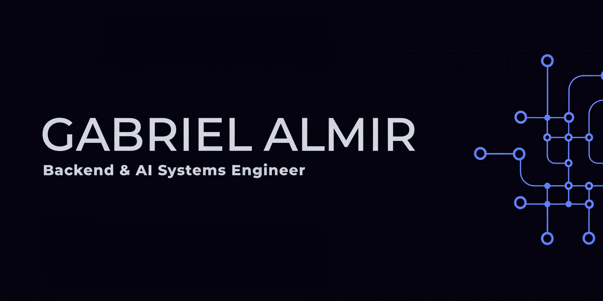

<h1 align="center">Gabriel Almir</h1>
<p align="center"><strong>Systems Analyst · Backend &amp; AI Systems</strong><br/>
TypeScript / Node.js • Python • ERP Integrations • Regulated Systems</p>

<p align="center">
  <a href="https://linkedin.com/in/gabrielalmir"></a>
  <a href="https://gabrielalmir.com.br"></a>
  <a href="https://ko-fi.com/gabrielalmir"></a>
</p>

## About

I build backend systems and integrations where **traceability, consistency and operational continuity** are real product requirements.

My work is centered on **Node.js, TypeScript and Python**, with experience in ERP integrations (SAP/TOTVS), APIs, data flows and regulated environments (BPF/GMP). I am expanding this foundation into **AI systems**: model integration, MCP, evaluation, guardrails, observability and secure operation.

I work as a Systems Analyst at **Laboratório Cristália** in the pharmaceutical sector. I contributed to the evolution of [PhotoGIMP](https://github.com/Diolinux/PhotoGIMP) and today take part in organizing and reviewing the project.

## Selected work

| Project                                                                | What it demonstrates                                                                                               |
| ---------------------------------------------------------------------- | ------------------------------------------------------------------------------------------------------------------ |
| [Pimbas](https://github.com/gabrielalmir/pimbas)                       | Architectural evolution: domain modeling, contract preservation during migration, per-group data isolation.        |
| [Saturno](https://github.com/gabrielalmir/saturno)                     | Product architecture: a modern Laravel/Inertia monolith with a modular boundary instead of premature distribution. |
| [Maybe](https://github.com/gabrielalmir/maybe)                         | Errors and absence as explicit states, adopted incrementally at the edges of PHP 7.4 systems.                      |
| [Hush](https://github.com/gabrielalmir/hush)                           | RESP-compatible server: what concurrency, memory and TTL semantics have to make explicit.                          |
| [MCP AnimagineXL](https://github.com/gabrielalmir/anime-diffusion-mcp) | Applied AI engineering: local image generation over MCP, with documented GPU requirements.               |

More dossiers and labs — including [Resulta](https://github.com/gabrielalmir/resulta), [Astrum](https://github.com/gabrielalmir/astrum) and [D4Sign Node](https://github.com/gabrielalmir/d4sign-node) — at [gabrielalmir.com.br](https://gabrielalmir.com.br).

## Engineering principles

- Start from the domain and make trade-offs explicit.
- Prefer reproducible systems: tests, documented decisions, containers and clear operational limits.
- Treat AI as a system component that needs evaluation, access control, observability and human review — not as magic.
- Keep sensitive data, internal processes and credentials out of public repositories.

## Current focus

Evaluation and guardrails for MCP servers; reporting pipelines over multiple databases.

- Reliable AI integrations with MCP, structured outputs and evaluation.
- Backend architecture for regulated and integration-heavy domains.
- Clear technical writing: architecture dossiers, limits and measurable outcomes.

## Stack

`TypeScript` · `Node.js` · `Python` · `NestJS` · `Fastify` · `PostgreSQL` · `Redis` · `Docker` · `AWS` · `GitHub Actions`

> "Não leio livros sobre o mundo. Saio por aí e vejo por mim mesmo." — Ezreal

## Portfolio development

The site is a static Astro portfolio in Brazilian Portuguese. The design uses ivory, graphite and cobalt, with Geist, Geist Mono and occasional Instrument Serif.
A centered graphite portrait and two static CSS plates lead the home; the experimental MCP case follows the opening.
A light/dark control follows the device on the first visit and saves manual choices. The home
positions backend and integration experience for AI Engineering opportunities, then presents the
experimental MCP case, professional evidence, backend projects and current studies.

- Public home copy and presentation order: `src/lib/content.ts`.
- Six case studies and their evidence/limits: `src/content/systems/*.md`.
- Shared visual system: `src/styles/global.css` and `src/styles/interactions.css`.
- MCP architecture explorer: `src/components/ArchitectureExplorer.astro`; Pimbas comparison:
  `src/components/PimbasComparison.astro`. Both retain all explanations without JavaScript.
- Local argument builder: `/projects/mcp-animaginexl#experimentar`. Its TypeScript only loads on
  that page. It checks local structure and a documented checklist, exports JSON and never sends
  generation requests. Sources are pinned in `src/lib/mcp.ts`.
- Existing `/projects/*` routes, section anchors, contacts, canonical URLs and sitemap are preserved.
- Navigation uses native scrolling and a native mobile disclosure. Native APIs handle interactions,
  menu focus and theme selection. Content, navigation and device-based theming work without JavaScript.
- Browser tests use an exclusive static server on port 4325, including HTTP 404 for `/404` variants.

Use Node.js 22.12+ (validated with Node.js 24) and install dependencies with `npm ci`.

```sh
npm run dev
npm run verify
```

Before browser tests, run `npx playwright install --with-deps chromium` in an environment that can
install Chromium's system libraries. The tests start the built static site themselves.

```sh
# Capture candidates for manual inspection without accepting snapshots:
REVIEW_SCREENSHOTS=1 npm run test:e2e -- --grep 'visual:'
# Review /tmp/gabriel-visual-review, then explicitly update and compare:
npm run test:e2e:update -- --grep 'visual:'
npm run test:e2e
# Build first, then audit three local mobile navigations:
npm run build
npm run measure:performance
# Capture three sizes, both themes and selected/invalid interaction states:
node scripts/review-design.mjs portrait-before
# After implementation and inspection:
node scripts/review-design.mjs portrait-final
node scripts/compare-design.mjs portrait-before portrait-final portrait-comparison
# Check the public destinations emitted by the build:
node scripts/check-links.mjs
# Regenerate the social JPEG and ICO from the code-based identity:
npm run generate:brand
```

Lighthouse reports go to `reports/lighthouse/` and external-link results to
`reports/external-links.json` (both ignored). Measurements and known limits are recorded in
[the redesign validation notes](docs/redesign-validation.md). This implementation does not deploy
the site or invoke any AI model.

The AI Engineering iteration, source boundaries and behavioral checks are recorded in
[the implementation validation notes](docs/ai-engineering-validation.md).

The portrait, graphite and cobalt iteration is documented in
[the visual validation report](docs/portrait-validation.md), with a navigable local comparison at
`reports/design-review/portrait-comparison.html` after running the capture commands above.

## Security checks

With Node.js 24, Bash, curl and tar (Linux, macOS or WSL):

```sh
npm ci
npm run security:setup
npm run security
```

The setup installs Gitleaks 8.30.1 locally in `.tools/` after checking a pinned
SHA-256 checksum. No global installation is needed. Run checks separately with
`npm run security:secrets` (working tree, including uncommitted files),
`npm run security:history` (all local Git refs), and `npm run security:audit`.
Fetch remote refs first if you want to include newly published history.
Gitleaks uses its default rules and redacts detected values in logs. Only dependency
and generated-output directories are excluded; there is no baseline hiding findings.

[Security CI](.github/workflows/security.yml) runs on pull requests, pushes to main,
weekly, and manually. Its independent jobs check secrets and audit all npm dependencies,
including development dependencies. Moderate, high and critical vulnerabilities fail
the audit; findings must be fixed rather than bypassed. A failed check does not by itself
block an external deployment: require both `Gitleaks` and `npm audit` checks in branch
protection or the deployment provider before treating them as deployment gates.

[Dependabot](.github/dependabot.yml) proposes weekly npm and GitHub Actions updates.
Compatible npm updates are grouped; major versions remain separate. Pull requests are
not auto-merged. Dependabot alert/security-update settings are managed separately in
GitHub repository settings.

References: [Gitleaks](https://github.com/gitleaks/gitleaks),
[npm audit](https://docs.npmjs.com/cli/v11/commands/npm-audit),
[Dependabot configuration](https://docs.github.com/en/code-security/reference/supply-chain-security/dependabot-options-reference).
